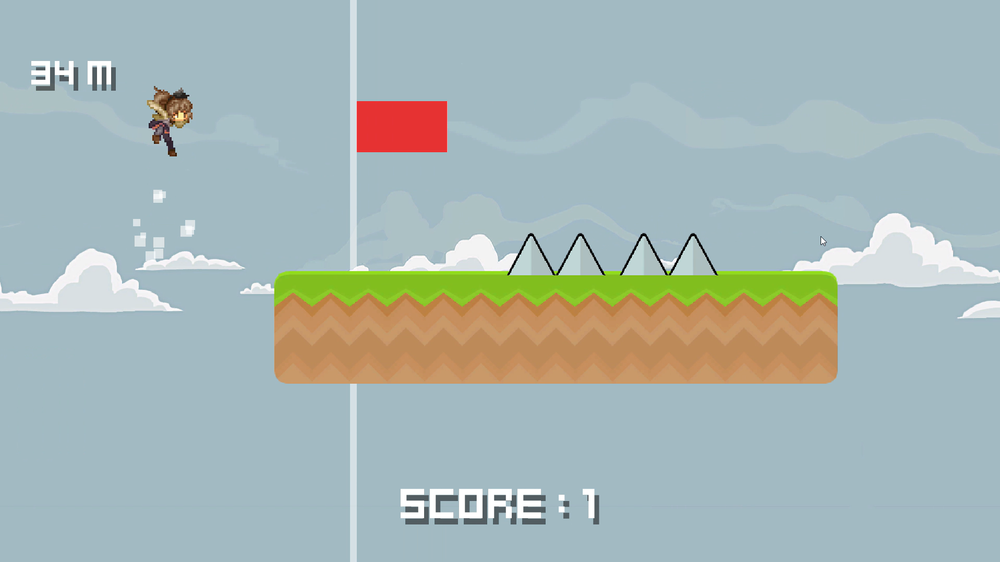

# UniRun

[▶ 플레이 영상 보기](https://youtu.be/KPieCj4RFr4)

자동으로 달리는 캐릭터를 점프로 조작해 발판 사이를 건너는 2D 러닝 게임입니다.

수업 실습으로 제공된 기본 프로젝트에 여섯 가지 기능을 추가했습니다.

- 엔진: Unity 6 (6000.5.10f1)
- 입력: New Input System

## 조작

| 키 | 동작 |
| --- | --- |
| 1 / 2 | 1인 / 2인 모드 선택 |
| Space / ↑ | 점프 (최대 2단, 짧게 누르면 낮게 점프) |
| 2인 모드 | P1 Space, P2 ↑ |

## 기본 프로젝트 (수업 제공)

- 점프와 2단 점프
- 발판과 장애물 생성
- 배경 반복 스크롤
- 점수와 재시작

## 추가한 기능

1. **죽은 지점 깃발** ([DeathFlag.cs](Assets/Scripts/DeathFlag.cs))
   직전 판에서 죽은 거리에 깃발을 세우고, 그 지점을 넘으면 기록 갱신 연출을 보여줍니다.
2. **연출 강화** ([PlayerController.cs](Assets/Scripts/PlayerController.cs), [CameraEffect.cs](Assets/Scripts/CameraEffect.cs))
   착지할 때 낙하 속도에 비례해 캐릭터가 찌그러지고, 사망할 때 히트스톱과 카메라 흔들림이 들어갑니다. 2단 점프에는 파티클이 나옵니다.
3. **낮밤 전환** ([DayNightCycle.cs](Assets/Scripts/DayNightCycle.cs))
   달린 거리에 따라 하늘 색이 바뀝니다. 발판은 색을 곱하는 방식으로는 원하는 색이 나오지 않아서, 같은 모양의 흰색 스프라이트를 위에 겹쳐 색을 입혔습니다.
4. **점진적 가속** ([GameManager.cs](Assets/Scripts/GameManager.cs))
   속도 7에서 시작해 14까지 서서히 빨라집니다. 발판 생성 간격을 시간이 아닌 달린 거리 기준으로 바꿔서 속도가 변해도 발판 간격이 유지됩니다.
5. **2인 대전**
   같은 맵에서 두 캐릭터가 달리고, 더 오래 살아남은 쪽이 이깁니다.
6. **사망 리플레이** ([ReplayRecorder.cs](Assets/Scripts/ReplayRecorder.cs))
   최근 1.25초 동안의 위치와 스프라이트를 계속 저장해 두었다가, 죽으면 그 장면을 구석의 작은 창에서 슬로모션으로 다시 보여줍니다.

## 리소스

- 캐릭터: Unity-chan (© Unity Technologies Japan/UCL, [Unity-Chan License](Assets/Sprites/License))
- 폰트: Kenney Mini Square (CC0)
